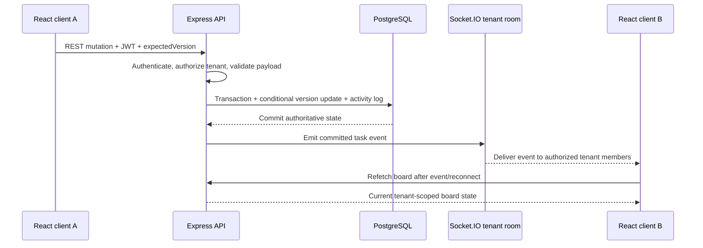

# Architecture and request flows

## Components

- React + Vite: authentication screens, organization/tenant selectors, Kanban board, task detail panel, optimistic task movement, activity view, and presence display.
- Express: authenticated REST API, validation, role checks, tenant/resource authorization, transaction boundaries, and audit logging.
- Socket.IO: authenticated tenant-scoped rooms; server-to-client events only for committed changes; presence connection tracking.
- PostgreSQL + Prisma: the eight assignment tables, foreign keys, indexes, and transactional persistence.

## Task mutation flow

## Tenancy boundary

The browser's selected tenant is context, not proof of access. Every tenant route checks the authenticated user's membership. Resource routes load the resource first and authorize against its stored tenant. Board/column/task relationships are checked before writes. Socket.IO authenticates the token and tenant membership before joining `tenant:<uuid>`; clients cannot select arbitrary room names.

## Concurrency

Task updates and moves require `expectedVersion`. The server uses a conditional update (`WHERE id = ? AND tenant_id = ? AND version = ?`) and increments the version on success. A stale request receives HTTP 409. Task reordering is committed transactionally at Serializable isolation; serialization conflicts are returned as HTTP 409 so the client can reload and retry.

## Undo/redo

Task activity entries preserve before/after snapshots. The current user's latest eligible task action can be reversed or reapplied. If the task has changed since the snapshot, the operation is rejected instead of overwriting newer work. This is a deliberately limited per-user history, not a global collaborative command stack.
