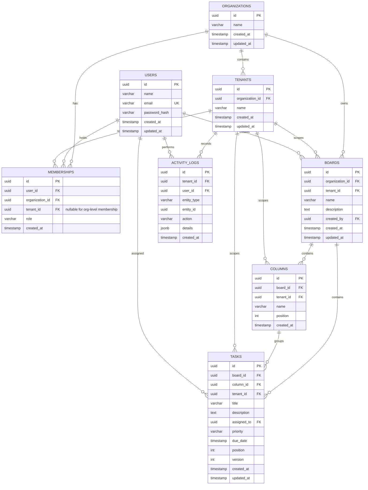

# Entity Relationship Diagram

The eight tables above are the eight tables specified in the assignment. Every tenant-owned business table includes `tenant_id`.

Rendered diagram: [`database-erd.png`](database-erd.png). Editable Graphviz source: [`database-erd.dot`](database-erd.dot).
